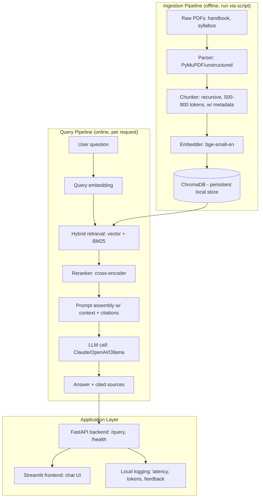
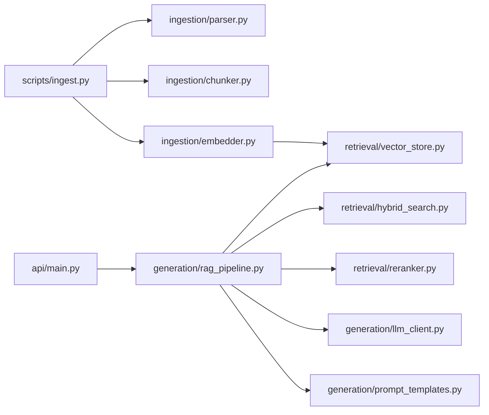

# AskMANIT — Project Specification & Build Plan

> **For Antigravity (or any AI dev agent):** This document is your single source of truth for building this project. Read it fully before writing any code. This project uses a **persistent task tracker** (Section 7) — always check `tasks/tasks.json` and `PROJECT_STATE.md` before starting work in any session, and update them after every completed task. This is how work resumes correctly even across interrupted sessions.

---

## 1. Project Overview

**Name:** AskMANIT
**One-line pitch:** A retrieval-augmented generation (RAG) chatbot that answers student questions about MANIT's academic handbook, syllabus, and institutional policies — with citations, so answers are verifiable and not hallucinated.

**Target users:** MANIT students and prospective students asking things like:
- "What is the minimum attendance requirement to sit for exams?"
- "How many credits do I need to graduate?"
- "What happens to my CGPA if I have a backlog in semester 3?"
- "What is the grading scale?"

**Non-goals for v1:**
- No cloud deployment (AWS) — this comes later, as a separate phase, only after the local system is working and evaluated.
- No multi-institute support — MANIT only, for now.
- No authentication/user accounts.
- No mobile app.

**Definition of "done" for v1:** A locally running system (API + simple UI) that ingests MANIT handbook/syllabus PDFs, answers questions with cited sources, and has been evaluated against a test set with recorded metrics.

---

## 2. Core Design Decisions (locked in — do not re-litigate these mid-build)

| Decision | Choice | Reasoning |
|---|---|---|
| Orchestration framework | **LangChain** | Most widely recognized in job postings; large ecosystem |
| Vector store | **ChromaDB** (local, persistent, file-based) | Zero external dependency, no cloud account needed |
| Embeddings | **`BAAI/bge-small-en-v1.5`** via `sentence-transformers` (local, free) | No API cost during dev; swappable later |
| LLM | **Pluggable via config**: Anthropic Claude API (default) or OpenAI, with Ollama (local Llama 3) as a free fallback | Keeps cost near-zero during dev if Ollama is used; production-quality if API key is available |
| PDF/table parsing | **PyMuPDF** (`fitz`) + **`unstructured`** for table-heavy pages | Handbooks have grading/credit tables — plain text extraction loses this structure |
| Backend | **FastAPI** | Standard, async, auto-docs, resume-relevant |
| Frontend (v1) | **Streamlit** | Fastest path to a working, demoable chat UI |
| Reranking | **Cross-encoder** (`sentence-transformers` `ms-marco-MiniLM`) | Free, local, no API dependency |
| Evaluation | **`ragas`** | Standard RAG eval library (faithfulness, context precision, answer relevancy) |
| Deployment (v1) | **Local only** — `uvicorn` + optional Docker Compose | AWS is explicitly deferred to a future phase (Section 9) |

---

## 3. Architecture

### 3.1 System Architecture



### 3.2 Backend Module Structure



---

## 4. End-to-End Workflow

**Ingestion (run once, or whenever source docs change):**
1. Place raw PDFs in `data/raw/`
2. Run `scripts/ingest.py`
3. → Parses → chunks (tagged with `source_doc`, `page_number`, `section_heading`) → embeds → writes to ChromaDB in `data/chroma_db/`

**Query (per user request):**
1. User types a question in Streamlit UI
2. UI calls FastAPI `/query` endpoint
3. Backend embeds the query, runs hybrid search (vector + BM25) against ChromaDB
4. Top-k candidates reranked by cross-encoder
5. Reranked context + question assembled into prompt (system prompt enforces: *answer only from context, cite page/section, refuse if not found*)
6. LLM generates answer
7. Response + citations returned to UI, logged locally (latency per stage, tokens, timestamp)

---

## 5. Tech Stack Summary

```
Python 3.11+
langchain, langchain-community
chromadb
sentence-transformers
rank-bm25
pymupdf, unstructured
fastapi, uvicorn, pydantic
streamlit
ragas
anthropic (and/or openai) — pluggable
python-dotenv
pytest
```

---

## 6. Folder Structure

> **This is Task T0.2 — create this exact structure before any other code.**

```
askmanit/
├── PROJECT_STATE.md              # human-readable current status (Section 7)
├── tasks/
│   └── tasks.json                # machine-readable task tracker (Section 7)
├── data/
│   ├── raw/                      # original PDFs go here (gitignored except .gitkeep)
│   ├── processed/                # extracted/chunked text (gitignored)
│   ├── chroma_db/                # persistent vector store (gitignored)
│   └── eval/
│       └── eval_set.json         # Q&A pairs for evaluation
├── src/
│   ├── config.py                 # central settings (env vars, model choices)
│   ├── ingestion/
│   │   ├── parser.py
│   │   ├── chunker.py
│   │   └── embedder.py
│   ├── retrieval/
│   │   ├── vector_store.py
│   │   ├── hybrid_search.py
│   │   └── reranker.py
│   ├── generation/
│   │   ├── llm_client.py
│   │   ├── prompt_templates.py
│   │   └── rag_pipeline.py
│   ├── api/
│   │   ├── main.py
│   │   ├── routes.py
│   │   └── schemas.py
│   └── eval/
│       └── run_eval.py
├── frontend/
│   └── streamlit_app.py
├── notebooks/
│   └── 00_prototype.ipynb        # scratch space for early manual testing
├── tests/
│   ├── test_ingestion.py
│   ├── test_retrieval.py
│   └── test_api.py
├── scripts/
│   ├── ingest.py                 # runs full ingestion pipeline
│   └── eval.py                   # runs full eval suite
├── logs/                         # local jsonl logs (gitignored)
├── .env.example
├── requirements.txt
├── README.md
└── .gitignore
```

---

## 7. Task Tracker System (build this FIRST — Phase 0)

The project must be self-tracking so that **any session, even a brand-new one with no memory of prior sessions, can resume correctly.** This is done with two files:

### 7.1 `PROJECT_STATE.md` (human-readable pointer)

Create this template at the project root:

```markdown
# AskMANIT — Project State

**Last updated:** <ISO timestamp>
**Current phase:** Phase 0 — Bootstrap
**Current task:** T0.1
**Overall status:** In progress

## How to resume
1. Read `tasks/tasks.json`.
2. Find the first task with `"status": "in_progress"`. If none, find the
   first task with `"status": "todo"` whose `depends_on` are all `"done"`.
3. That is your next task. Work on ONLY that task.
4. On completion: set its status to `"done"`, fill `completed_at`, add a
   one-line `notes` entry, then update the "Current task" line above to the
   next task's ID.
5. Commit with message: `feat(<task_id>): <short description>`

## Decisions log
- <date> — Chose LangChain over LlamaIndex: see Section 2 of spec.

## Blockers
- (none yet)

## Eval results (filled in during Phase 4)
- Baseline faithfulness: TBD
- Baseline context precision: TBD
- Post-hybrid-search faithfulness: TBD
```

### 7.2 `tasks/tasks.json` (machine-readable tracker)

Seed this file with the full task list below. Each task has this schema:

```json
{
  "id": "T0.1",
  "phase": 0,
  "title": "Short title",
  "description": "What to actually do",
  "acceptance_criteria": "How to know it's really done",
  "depends_on": [],
  "status": "todo",
  "completed_at": null,
  "notes": ""
}
```

`status` is always one of: `"todo"`, `"in_progress"`, `"done"`, `"blocked"`.

**Full seed list (create `tasks/tasks.json` with exactly these tasks):**

<details>
<summary>Phase 0 — Bootstrap & Task Tracking (click to expand task list)</summary>

- **T0.1** Initialize git repo, `.gitignore`, `README.md` skeleton
- **T0.2** Create full folder structure per Section 6
- **T0.3** Create `PROJECT_STATE.md` from template in Section 7.1
- **T0.4** Create `tasks/tasks.json` seeded with all tasks in this document
- **T0.5** Create `requirements.txt` and set up virtual environment
- **T0.6** Create `.env.example` (keys: `ANTHROPIC_API_KEY`, `OPENAI_API_KEY`, `LLM_PROVIDER`, `USE_OLLAMA`)
- **T0.7** Build `src/config.py` — loads env vars, exposes model/provider settings

</details>

<details>
<summary>Phase 1 — Data Ingestion</summary>

- **T1.1** Collect MANIT handbook + syllabus PDFs into `data/raw/`
- **T1.2** Build `ingestion/parser.py` — extract text + tables from PDFs
- **T1.3** Build `ingestion/chunker.py` — recursive chunking (500–800 tokens, overlap), tag each chunk with `source_doc`, `page_number`, `section_heading`
- **T1.4** Build `ingestion/embedder.py` — wraps `bge-small-en-v1.5`
- **T1.5** Build `scripts/ingest.py` — runs parser → chunker → embedder → writes to ChromaDB
- **T1.6** Manual QA — inspect 5 sample chunks for correctness (no broken tables/sentences)

</details>

<details>
<summary>Phase 2 — Retrieval</summary>

- **T2.1** Build `retrieval/vector_store.py` — ChromaDB client, persistent, add/query functions
- **T2.2** Implement basic top-k similarity search
- **T2.3** Build `retrieval/hybrid_search.py` — combine vector search with BM25 (`rank-bm25`)
- **T2.4** Build `retrieval/reranker.py` — cross-encoder reranking of hybrid results
- **T2.5** Draft 10 sample questions (spanning easy/numeric/multi-hop) and manually verify retrieval quality against them — save these as the seed for `data/eval/eval_set.json`

</details>

<details>
<summary>Phase 3 — Generation / RAG Chain</summary>

- **T3.1** Build `generation/llm_client.py` — pluggable Claude/OpenAI/Ollama wrapper, chosen via `LLM_PROVIDER` env var
- **T3.2** Build `generation/prompt_templates.py` — system prompt enforcing context-only answers, citations, and refusal when the answer isn't in the handbook
- **T3.3** Build `generation/rag_pipeline.py` — wires retrieval + rerank + prompt + LLM call into one function
- **T3.4** Add citation formatting to output (page/section per claim)
- **T3.5** Add out-of-scope refusal handling (test with an unrelated question, e.g. "what's the weather today")
- **T3.6** Manual end-to-end test against the 10 sample questions from T2.5

</details>

<details>
<summary>Phase 4 — Evaluation</summary>

- **T4.1** Expand `data/eval/eval_set.json` to 30–50 Q&A pairs (easy factual, numeric, multi-hop, and out-of-scope)
- **T4.2** Integrate `ragas` — faithfulness, context precision, answer relevancy
- **T4.3** Build `src/eval/run_eval.py` + `scripts/eval.py` to run the full eval set and print/save a report
- **T4.4** Run baseline eval (vector search only, no rerank) — record metrics in `PROJECT_STATE.md`
- **T4.5** Enable hybrid search + reranking, re-run eval, record delta in `PROJECT_STATE.md`

</details>

<details>
<summary>Phase 5 — Backend API</summary>

- **T5.1** Build `api/main.py` — FastAPI app skeleton
- **T5.2** Build `api/schemas.py` — Pydantic request/response models
- **T5.3** Build `/query` endpoint wired to `rag_pipeline.py`
- **T5.4** Add streaming response support (SSE)
- **T5.5** Add `/health` endpoint
- **T5.6** Add structured local logging (query, retrieved chunk IDs, latency per stage, token counts) to `logs/`
- **T5.7** Add basic error handling middleware
- **T5.8** Write `tests/test_api.py`

</details>

<details>
<summary>Phase 6 — Frontend</summary>

- **T6.1** Build `frontend/streamlit_app.py` — chat UI calling the local API
- **T6.2** Display citations/sources alongside each answer
- **T6.3** Add in-session chat history
- **T6.4** Add thumbs up/down feedback, logged locally
- **T6.5** Basic branding/styling as "AskMANIT"

</details>

<details>
<summary>Phase 7 — Local Monitoring (pre-AWS)</summary>

- **T7.1** Log per-stage latency (embed/retrieve/rerank/LLM) to `logs/latency.jsonl`
- **T7.2** Build a simple local stats view (extra Streamlit page or notebook) plotting latency and feedback trends over time
- **T7.3** Track and display estimated token cost per query

</details>

<details>
<summary>Phase 8 — Documentation & Packaging</summary>

- **T8.1** Write full `README.md`: problem statement, architecture diagram, setup steps, screenshots
- **T8.2** Embed the Mermaid architecture diagrams from Section 3 into the README
- **T8.3** Add the eval results table to the README
- **T8.4** Record a short demo GIF/video of the chat UI in action
- **T8.5** (Optional) Add `docker-compose.yml` for one-command local run

</details>

<details>
<summary>Phase 9 — Cloud Deployment (DO NOT START — future phase, separate spec)</summary>

- Explicitly out of scope for this document. Do not begin AWS work until Phases 0–8 are complete and the user confirms readiness to proceed. A separate spec will define the AWS architecture (API on ECS/Lambda, RDS+pgvector, CloudWatch/X-Ray monitoring) when that phase begins.

</details>

---

## 8. Session Protocol (read this every time, every session)

1. Open `PROJECT_STATE.md`. Note the "Current task."
2. Open `tasks/tasks.json`. Confirm that task's status and its `depends_on` are all `"done"`.
3. Set that task's status to `"in_progress"`.
4. Do the work. Only that task — do not jump ahead to later phases even if it seems faster.
5. Verify against the task's `acceptance_criteria`.
6. Update `tasks/tasks.json`: status → `"done"`, fill `completed_at`, write a one-line `notes` summary (what was built, any deviation from spec, any follow-up needed).
7. Update `PROJECT_STATE.md`: bump "Last updated," advance "Current task" to the next eligible task, add to "Decisions log" if any non-trivial choice was made, add to "Blockers" if stuck.
8. If genuinely blocked (missing data, unclear requirement), set status to `"blocked"`, write why in `notes`, and stop — don't guess past a real blocker silently.
9. Commit: `feat(<task_id>): <short description>`.

This loop is what makes the project resumable indefinitely, across any number of separate sessions.

---

## 9. Explicitly Deferred (not in this document's scope)

- AWS deployment (ECS/Lambda/RDS/CloudWatch) — future phase
- Authentication / multi-user accounts
- Multi-institute generalization
- Mobile app
- Fine-tuning any model

---

*End of spec. Start at Task T0.1.*
