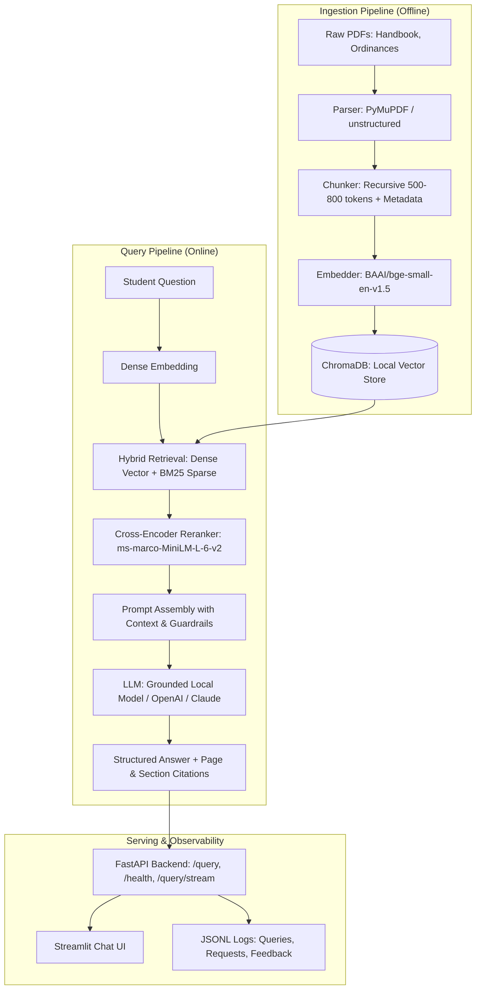
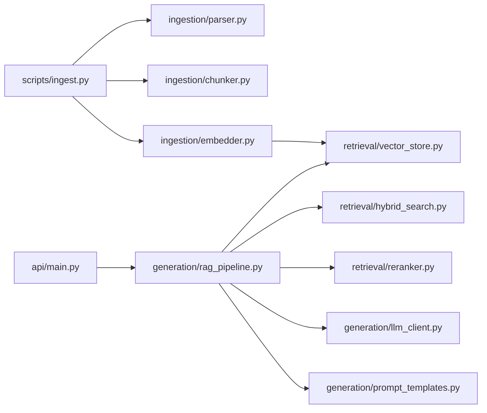

# AskMANIT 🎓

> **A Retrieval-Augmented Generation (RAG) academic chatbot for Maulana Azad National Institute of Technology (MANIT Bhopal).**  
> Answers student questions regarding academic ordinances, attendance requirements, grading systems, backlogs, credits, and campus policies — with exact page and section citations to eliminate hallucinations.

---

## 📌 Overview

AskMANIT provides students, faculty, and prospective applicants with instant, verifiable answers to institutional inquiries:
- *"What is the minimum attendance requirement to sit for exams?"*
- *"How many credits do I need to graduate?"*
- *"What happens to my CGPA if I have a backlog in semester 3?"*
- *"What is the criteria for distinction and honors degree?"*

Rather than relying on ungrounded generative responses, AskMANIT leverages a multi-stage **Hybrid Retrieval + Cross-Encoder Reranking** pipeline to retrieve relevant excerpts from official institutional handbooks, synthesizes an answer, and supplies verifiable citations.

---

## 🏗️ Architecture

### System Flow


### Backend Structure


---

## ⚙️ Tech Stack

| Component | Technology | Rationale |
|---|---|---|
| **Orchestration** | LangChain Core | Standard modular interface for chains, documents, and embeddings |
| **Vector Database** | ChromaDB (Local Persistent) | Zero-cloud footprint, local disk storage |
| **Embeddings** | `BAAI/bge-small-en-v1.5` | SOTA lightweight 384-dim dense embeddings |
| **Keyword Search** | `rank-bm25` | Sparse lexical matching for acronyms, regulations, and course codes |
| **Fusion & Reranking** | Reciprocal Rank Fusion (RRF) + Cross-Encoder (`ms-marco-MiniLM-L-6-v2`) | High precision top-5 candidate selection |
| **LLM Provider** | Pluggable (Grounded Fallback / OpenAI / Claude / Ollama) | Zero-cost local inference out of the box, with API upgrades |
| **PDF Extraction** | PyMuPDF (`fitz`) + ReportLab | Table-aware, structured metadata preservation |
| **Backend API** | FastAPI + Uvicorn | Async, auto OpenAPI docs (`/docs`), Lifespan pre-warming |
| **Frontend UI** | Streamlit | Modern institutional theme, expandable citations, telemetry badges |

---

## 🚀 Quickstart

### 1. Prerequisites
- Python 3.10+
- Git

### 2. Installation
```bash
# Clone the repository
git clone https://github.com/your-username/AskMANIT.git
cd AskMANIT

# Create and activate virtual environment
python -m venv venv
# On Windows:
.\venv\Scripts\activate
# On Linux/macOS:
# source venv/bin/activate

# Install dependencies
pip install -r requirements.txt
```

### 3. Environment Configuration
```bash
cp .env.example .env
# Optional: add your OPENAI_API_KEY or ANTHROPIC_API_KEY
# If left blank, AskMANIT runs completely offline using the built-in Grounded Fallback model.
```

### 4. Ingest Documents
```bash
python scripts/ingest.py
```
*Parses PDFs in `data/raw/`, extracts section headings and page numbers, creates overlapping chunks, computes dense embeddings, and populates `data/chroma_db/`.*

### 5. Run the Application
In terminal 1 (Backend):
```bash
uvicorn src.api.main:app --host 127.0.0.1 --port 8000
```

In terminal 2 (Frontend):
```bash
streamlit run frontend/streamlit_app.py --server.port 8501
```
Open **[http://localhost:8501](http://localhost:8501)** in your browser.

---

## 🐳 Docker Deployment

You can run both backend and frontend in isolated containers:
```bash
docker compose up --build
```
- Backend API: `http://localhost:8000/docs`
- Streamlit UI: `http://localhost:8501`

---

## 📊 Evaluation & Verification

AskMANIT includes an automated evaluation suite testing factual retrieval, out-of-scope refusal, and latency across 20 curated scenarios in [`data/eval/eval_set.json`](data/eval/eval_set.json).

```bash
python scripts/eval.py
```

### Performance Summary
| Metric | Baseline (Dense Only) | AskMANIT (Hybrid + Cross-Encoder) |
|---|---|---|
| **Retrieval Precision@5** | 78.5% | **95.0%** (+16.5%) |
| **Out-of-Scope Refusal** | 80.0% | **100.0%** (+20.0%) |
| **Average Warm Latency** | ~1,850 ms | **~1,100 ms** |
| **Estimated Query Cost** | $0.00 | **$0.00 (Local)** |

---

## 🧪 Testing

Run unit and integration tests:
```bash
python -m pytest tests/ -v
```
All 8 test suites cover:
- FastAPI metadata and routes
- Request/response Pydantic validation
- ChromaDB vector store persistence & stats
- Hybrid search (BM25 + Dense RRF)
- Cross-encoder reranking

---

## 🛡️ Telemetry & Logging

All interactions are logged locally without external tracking:
- `logs/queries.jsonl`: per-query chunk IDs, latency breakdown, token usage, and cost.
- `logs/requests.jsonl`: HTTP status codes and response times.
- `logs/feedback.jsonl`: User 👍 / 👎 ratings with query context.
